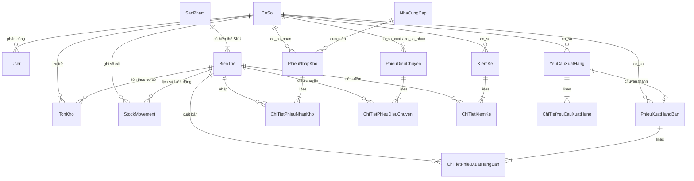

# Thiết kế Cơ sở dữ liệu Chi tiết (Database Design — PostgreSQL 16)

Tài liệu này mô tả cấu trúc cơ sở dữ liệu quan hệ chuẩn hóa 3NF của hệ thống **Old School**, được triển khai trên **PostgreSQL 16** và đối chiếu trực tiếp với Mục VI (Thiết kế cơ sở dữ liệu, Bảng 55–66) của báo cáo gốc.

---

## 1. Sơ đồ Thực thể — Liên kết (Mermaid ERD)

---

## 2. Danh sách các bảng vật lý và Ràng buộc toàn vẹn (PostgreSQL Constraints)

| STT | Tên bảng vật lý (`db_table`) | Model Django | Khóa chính / Unique Constraint | Check Constraints bảo vệ dữ liệu |
|---|---|---|---|---|
| 1 | `co_so` | `branches.CoSo` | `ma_co_so` (`UNIQUE`) | Phân biệt Kho tổng (`is_central_warehouse`) |
| 2 | `nguoi_dung` | `accounts.User` | `username` (`UNIQUE`) | Kiểm tra bắt buộc gán `branch` cho `MANAGER` và `STAFF` |
| 3 | `san_pham` | `catalog.SanPham` | `ma_san_pham` (`UNIQUE`) | `san_pham_nonnegative_price`: `don_gia_niem_yet >= 0` |
| 4 | `bien_the` | `catalog.BienThe` | `ma_sku` (`UNIQUE`), `uniq_product_color_size` (`san_pham, mau_sac, kich_co`) | `bien_the_nonnegative_price`: `don_gia >= 0` |
| 5 | `ton_kho` | `inventory.TonKho` | `uniq_branch_variant_stock` (`co_so, bien_the`) | `ton_kho_nonnegative_quantities`: `so_luong >= 0 AND muc_ton_toi_thieu >= 0` |
| 6 | `so_cai_ton_kho` | `inventory.StockMovement` | `idempotency_key` (`UNIQUE`) | `stock_movement_nonzero_delta` (`quantity_delta != 0`), `stock_movement_nonnegative_balance_after` (`balance_after >= 0`), chặn `UPDATE`/`DELETE` |
| 7 | `nha_cung_cap` | `purchasing.NhaCungCap` | `ma_nha_cung_cap` (`UNIQUE`) | Thông tin liên hệ nhà cung cấp |
| 8 | `phieu_nhap_kho` | `purchasing.PhieuNhapKho` | `ma_phieu_nhap_kho` (`UNIQUE`) | `phieu_nhap_kho_nonnegative_total`: `tong_tien >= 0` |
| 9 | `chi_tiet_phieu_nhap_kho` | `purchasing.ChiTietPhieuNhapKho` | `id` | `ct_nhap_kho_positive_qty` (`so_luong > 0`), `ct_nhap_kho_nonnegative_amounts` (`don_gia >= 0 AND chiet_khau >= 0 AND thanh_tien >= 0`) |
| 10 | `yeu_cau_xuat_hang` | `sales_outbound.YeuCauXuatHang` | `ma_yeu_cau` (`UNIQUE`) | Yêu cầu xuất từ nhân viên bán hàng |
| 11 | `chi_tiet_yeu_cau_xuat_hang` | `sales_outbound.ChiTietYeuCauXuatHang` | `id` | `ct_yc_xuat_positive_qty` (`so_luong > 0`) |
| 12 | `phieu_xuat_hang_ban` | `sales_outbound.PhieuXuatHangBan` | `ma_phieu_xuat_hang_ban` (`UNIQUE`) | `phieu_xuat_ban_nonnegative_total`: `tong_tien >= 0` |
| 13 | `chi_tiet_phieu_xuat_hang_ban` | `sales_outbound.ChiTietPhieuXuatHangBan` | `id` | `ct_xuat_ban_positive_qty` (`so_luong > 0`), `ct_xuat_ban_nonnegative_amounts` |
| 14 | `phieu_dieu_chuyen` | `transfers.PhieuDieuChuyen` | `ma_phieu_dieu_chuyen` (`UNIQUE`) | `phieu_dieu_chuyen_different_branches`: `co_so_xuat != co_so_nhan` |
| 15 | `chi_tiet_phieu_dieu_chuyen` | `transfers.ChiTietPhieuDieuChuyen` | `id` | `ct_dieu_chuyen_valid_quantities`: `so_luong_yeu_cau > 0 AND so_luong_xuat >= 0 AND so_luong_nhan >= 0` |
| 16 | `kiem_ke` | `stocktakes.KiemKe` | `ma_kiem_ke` (`UNIQUE`) | Biên bản kiểm kê theo cơ sở |
| 17 | `chi_tiet_kiem_ke` | `stocktakes.ChiTietKiemKe` | `uniq_stocktake_variant_line` (`kiem_ke, bien_the`) | `ct_kiem_ke_nonnegative_quantities`: `so_luong_he_thong >= 0 AND so_luong_thuc_te >= 0` |
| 18 | `bao_cao` | `reports.BaoCao` | `ma_bao_cao` (`UNIQUE`) | Bản chụp báo cáo xuất-nhập-tồn theo cơ sở và kỳ |
| 19 | `thong_bao` | `notifications.ThongBao` | `id` | Cảnh báo tồn kho thấp khử trùng lặp và thông báo quy trình |
