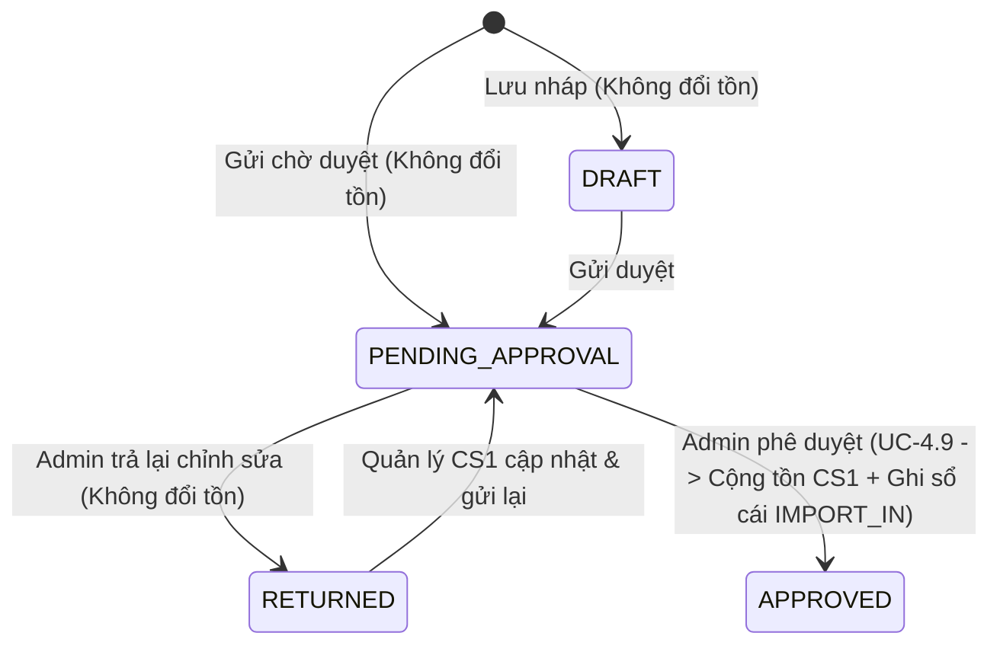
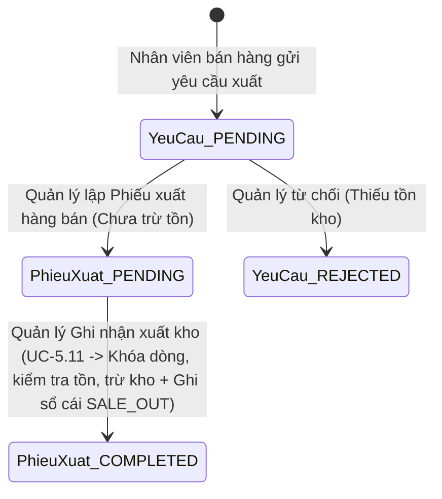
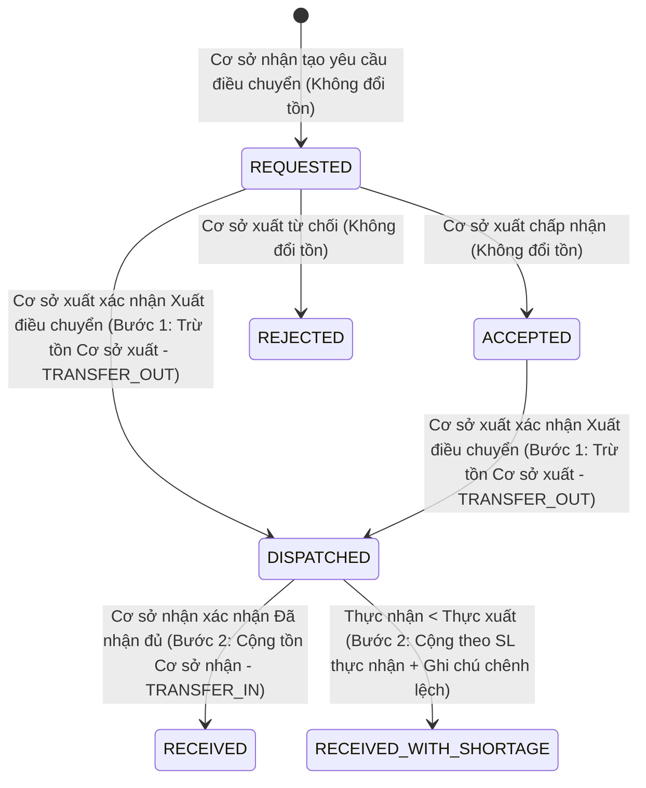
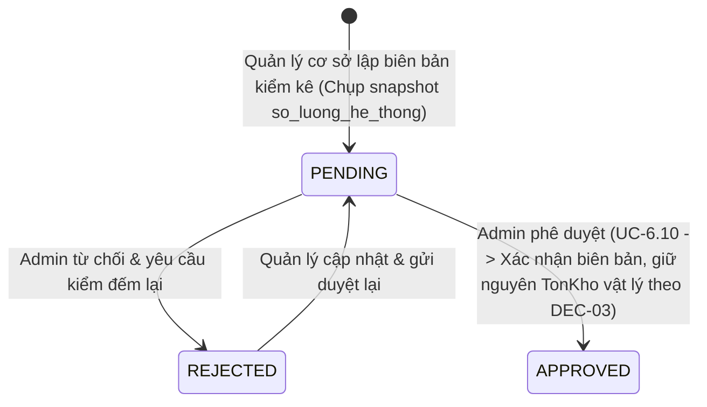

# Quy trình Nghiệp vụ & Cơ chế Hạch toán Sổ cái Tồn kho (`STOCK_WORKFLOWS.md`)

Mọi biến động số lượng tồn kho (`TonKho.so_luong`) trong hệ thống **Old School** đều bắt buộc đi qua dịch vụ trung tâm [`apply_stock_movements`](../apps/inventory/services.py) trong một giao dịch nguyên tử (`@transaction.atomic`) sử dụng khóa dòng bi quan (`select_for_update()`) theo thứ tự tăng dần của `bien_the_id`.

---

## 1. Quy trình Nhập kho tại Kho tổng CS1 (`UC-4.1` – `UC-4.11`)

- **Điểm kiểm soát quan trọng (`DEC-01`)**: Khi Quản lý CS1 tạo hoặc sửa phiếu nhập, tồn kho hoàn toàn chưa thay đổi. Chỉ khi `ADMIN` bấm **Duyệt phiếu nhập**, hệ thống mới khóa dòng `TonKho` của CS1, cộng số lượng nhập, tạo bút toán `StockMovement(movement_type="IMPORT_IN")` và tự động đóng các cảnh báo sắp hết hàng nếu tồn mới vượt định mức tối thiểu.

---

## 2. Quy trình Xuất kho bán hàng (`UC-5.1`, `UC-5.2`, `UC-5.4` – `UC-5.13`)

- **Kiểm soát tương tranh & Chống âm kho**: Khi bấm **Ghi nhận xuất kho** (`finalize_outbound_receipt`), hệ thống khóa `TonKho` bằng `select_for_update()`. Nếu `so_luong_hien_tai < so_luong_xuat`, toàn bộ giao dịch bị hủy (`InsufficientStockError`), tuyệt đối không cho phép tồn kho âm.
- **Cảnh báo tồn kho tự động (`UC-5.13`)**: Ngay sau khi trừ tồn, `sync_low_stock_alert` kiểm tra nếu `so_luong <= muc_ton_toi_thieu` sẽ sinh (hoặc cập nhật tại chỗ không trùng lặp) thông báo `LOW_STOCK_ALERT`.

---

## 3. Quy trình Điều chuyển Nội bộ 2 bước (`UC-5.3`)

- **Hạch toán 2 bước chuẩn xác**:
  1. Khi cơ sở xuất bấm **Xuất điều chuyển** (`DISPATCHED`), hàng rời kho xuất nên tồn kho cơ sở xuất giảm ngay (`TRANSFER_OUT`), nhưng tồn kho cơ sở nhận **chưa tăng** (lượng hàng này được Báo cáo ghi nhận vào cột **Đang vận chuyển / In-Transit**).
  2. Chỉ khi cơ sở nhận bấm **Xác nhận Đã nhận hàng** (`RECEIVED` / `RECEIVED_WITH_SHORTAGE`), tồn kho cơ sở nhận mới tăng theo `so_luong_nhan` (`TRANSFER_IN`).

---

## 4. Quy trình Kiểm kê kho (`UC-6.1` – `UC-6.10`)

