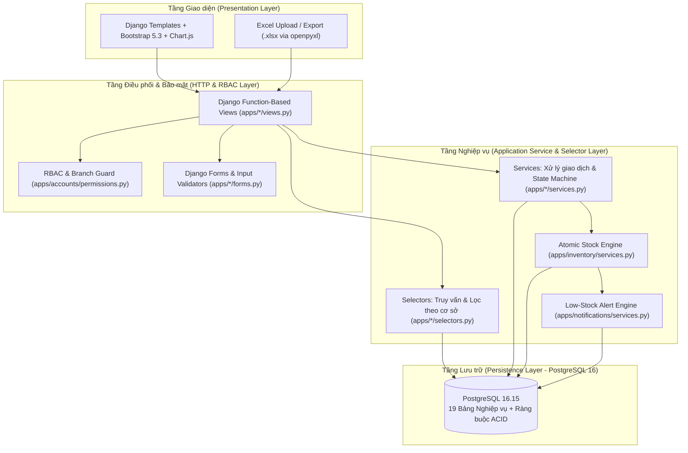

# Kiến trúc Hệ thống Tổng thể (System Architecture)

Tài liệu này mô tả kiến trúc tổng thể, luồng dữ liệu, cơ chế đồng bộ tồn kho và bảo mật của hệ thống **Old School Inventory Management System**.

---

## 1. Sơ đồ Kiến trúc Phân lớp (High-Level Architecture)

---

## 2. Nguyên tắc Thiết kế Cốt lõi

### 2.1. Sổ cái Tồn kho Bất biến & Khóa Bi quan (`TonKho` + `StockMovement`)
- Bảng `TonKho` lưu số dư tức thời của từng cặp `(bien_the, co_so)` kèm ràng buộc mức CSDL `CHECK (so_luong >= 0)`.
- Bảng `StockMovement` lưu toàn bộ biến động lịch sử (`OPENING_BALANCE`, `PURCHASE_IN`, `SALE_OUT`, `TRANSFER_OUT`, `TRANSFER_IN`) với `balance_before`, `quantity_change`, `balance_after`.
- Mọi thao tác cộng/trừ tồn kho đều đi qua `apply_stock_movements()`:
  1. Khóa dòng `TonKho` theo thứ tự định sẵn (`ORDER BY bien_the_id ASC`) bằng `SELECT ... FOR UPDATE`.
  2. Kiểm tra số dư khả dụng trước khi trừ.
  3. Ghi nhận đồng thời vào `TonKho` và `StockMovement` trong cùng một `@transaction.atomic`.
  4. Đồng bộ cảnh báo tồn kho thấp (`ThongBao`) ngay trong transaction.

### 2.2. Cô lập Dữ liệu Đa Cơ sở (Multi-Branch Isolation)
- **Chủ cửa hàng (`ADMIN`)**: Có bộ chuyển đổi cơ sở (`Toàn chuỗi`, `CS1`, `CS2`) trên thanh điều hướng; có độc quyền phê duyệt/trả lại phiếu nhập kho (`UC-4.9`) và phê duyệt/từ chối biên bản kiểm kê (`UC-6.10`).
- **Quản lý Cơ sở 1 (`MANAGER` - `CS1`)**: Phụ trách Kho tổng & Cửa hàng 1; được lập phiếu nhập từ Nhà cung cấp, điều phối xuất điều chuyển sang `CS2`, quản lý xuất bán và kiểm kê tại `CS1`.
- **Quản lý Cơ sở 2 (`MANAGER` - `CS2`)**: Phụ trách Cửa hàng 2; tạo yêu cầu nhận điều chuyển từ `CS1`, xác nhận nhận hàng điều chuyển, quản lý xuất bán và kiểm kê tại `CS2`; **bị chặn hoàn toàn quyền tạo/xem phiếu nhập từ Nhà cung cấp và dữ liệu nội bộ của `CS1`**.
- **Nhân viên Bán hàng (`STAFF`)**: Tra cứu hàng hóa/tồn kho tại cơ sở phụ trách và tạo Yêu cầu xuất hàng (`YeuCauXuatHang`); bị chặn mọi thao tác sửa danh mục, duyệt phiếu, kiểm kê và báo cáo quản trị.
